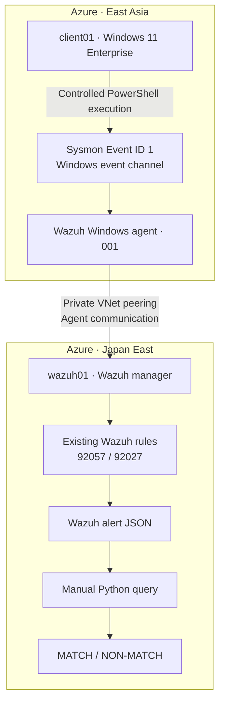

# Endpoint Telemetry and Investigation: Technical Lab

## Overview

Configured Windows endpoint telemetry with centralized collection in Wazuh, then investigated a controlled encoded PowerShell execution from process event to analyst decision.

It shows Sysmon process events collected through a Wazuh agent, local and central records matched to each other, an encoded-command check tested against an ordinary command, and a decision on whether the activity was authorized.

**Investigation question:** Did an encoded PowerShell invocation occur on `client01`, what did it actually execute, how was it recorded and detected, and did the evidence support authorized activity?

## Environment and Telemetry Path

| Component | Configuration |
|---|---|
| Hosting | Microsoft Azure, two private virtual networks connected through VNet peering |
| Endpoint | `client01`: Windows 11 Enterprise, joined to `northstar.test` (the client from the [Windows access lab](../windows-access-troubleshooting/README.md)) |
| Execution account | `client01\clientadmin` |
| Endpoint telemetry | Microsoft Sysmon 15.22, Event ID 1 (Process Create) |
| Collection agent | Wazuh Windows agent 4.14.8-1, agent ID `001` |
| Analysis server | `wazuh01`: Ubuntu 24.04, Wazuh 4.14.8 manager, indexer, and dashboard |
| Investigation period | October 20, 2026, 07:25–08:15 UTC |

`wazuh01` had no inbound ports open to the Internet. Agent traffic used the private VNet peering, and administration used Azure Bastion.

**Telemetry path:**

`PowerShell execution → Sysmon Operational channel → Wazuh agent → private VNet peering → Wazuh manager → existing Wazuh rules → alert JSON`



Collection was verified end to end by matching local Sysmon records to their Wazuh alerts. Both executions appear in both places.

## Investigation Case

### Controlled Test and Comparison

Two executions on `client01` used the same harmless operation, account, and PowerShell parent process. The marker file was reset between them.

| Execution | Invocation | Result |
|---|---|---|
| Positive | `powershell.exe -NoProfile -NonInteractive -EncodedCommand <UTF-16LE Base64>` | Exit code `0`; marker verified |
| Comparison | The same operation with `-Command` | Exit code `0`; marker verified after reset |

The 216-character Base64 argument recorded by Sysmon decoded (UTF-16LE) to:

```powershell
Set-Content -Path (Join-Path $env:TEMP 'ct-case2-marker.txt') -Value 'CT-P2-TEST'
```

This creates or overwrites a marker file in the executing user's temporary directory.

Evidence: [encoded PowerShell execution](evidence/encoded-powershell-execution.png) and [marker content verified](evidence/marker-content-validation.png).

### Timeline and Correlation

All timestamps are UTC on October 20, 2026.

| Time (UTC) | Source | Observed event |
|---|---|---|
| 07:28:10.051 | Test record | Encoded execution initiated |
| 07:28:10.812 | Sysmon Record `7960` | Encoded PowerShell process creation, child PID `10012` |
| 07:28:11.892 | Wazuh | Existing rule `92057`, level `12` |
| Following execution | Test validation | Exit code `0`; expected marker content verified |
| 08:12:08.866 | Test record | Ordinary-command comparison initiated |
| 08:12:08.890 | Sysmon Record `8016` | Ordinary PowerShell process creation, child PID `1052` |
| 08:12:09.940 | Wazuh | Existing rule `92027`, level `4` |
| Following execution | Test validation | Exit code `0`; marker content verified after reset |

| Field | Encoded execution | Ordinary comparison |
|---|---|---|
| Sysmon Event ID | 1 | 1 |
| EventRecordID | `7960` | `8016` |
| Child PID | `10012` | `1052` |
| Parent process / PID | `powershell.exe` / `1388` | `powershell.exe` / `1388` |
| Account | `client01\clientadmin` | `client01\clientadmin` |
| ProcessGuid | `{4ba3f2c9-180a-6ad7-f20f-000000000f00}` | `{4ba3f2c9-2258-6ad7-2410-000000000f00}` |
| Wazuh rule / level | `92057` / 12 | `92027` / 4 |
| Manual query result | **MATCH** | **NON-MATCH** |

Local and central records were correlated using the retained Sysmon XML and Wazuh alert JSON. Eight selected field-correlation checks passed for each event pair.

Evidence: [local Sysmon event, Record 7960](evidence/local-sysmon-event-7960.png) and [central Wazuh record of the ordinary comparison, Record 8016](evidence/central-ordinary-event-8016.png).

### Detection Logic

A manual Python query ([query logic](configuration/encoded-command-predicate.py)) evaluated the stored Wazuh alert JSON against four conditions:

1. Agent ID `001`.
2. Sysmon provider and Event ID `1`.
3. Executable basename `powershell.exe`.
4. The full `-EncodedCommand` token in the command line, matched case-insensitively.

The query identifies an execution characteristic, not malicious intent; encoding is also used in legitimate administrative automation.

Wazuh's existing rules fired on their own. The query was run separately against stored alerts and was never deployed as a Wazuh rule. The ordinary comparison still reached Wazuh, so its NON-MATCH came from the query condition itself.

Evidence: [manual query MATCH on the encoded execution](evidence/manual-query-positive-match.png) and [NON-MATCH on the ordinary comparison](evidence/manual-query-ordinary-nonmatch.png).

## Findings and Disposition

| Validation | Expected | Observed |
|---|---|---|
| Encoded execution collected locally and centrally | Yes | **Yes** |
| Encoded execution matches manual query | MATCH | **MATCH** |
| Ordinary execution collected locally and centrally | Yes | **Yes** |
| Ordinary execution matches manual query | NON-MATCH | **NON-MATCH** |
| Marker operation succeeds | Both executions | **Both executions** |

What the evidence shows:

- An encoded PowerShell invocation occurred on `client01` under the expected account and PowerShell parent.
- The captured argument decoded into the intended harmless marker-writing command, and the test output verified its effect.
- Local Sysmon and central Wazuh records agreed on the selected identifiers and process context.
- The ordinary comparison remained visible centrally while failing the encoded-specific query.

Could it have been unauthorized? An encoded PowerShell process would be suspicious if its account, parent, command, timing or surrounding activity didn't fit an approved operation. Here the recorded operator action, the decoded command, the process context, the timestamps and the marker check all fit the controlled test.

**Simulated disposition: CLOSE — authorized controlled lab activity. Analyst-assessed concern: Low.**

Wazuh rated the encoded execution level `12`. The decision weighed that score against the full context above. No alert-status change, containment or remediation was performed or required.

## Limitations

The findings apply to the two controlled executions and the investigated window.

- No PowerShell Event ID 4104 record was correlated to these executions; command content was reconstructed by decoding the Base64 argument captured by Sysmon.
- Marker validation came from the test's own output. No file-creation event was correlated.
- Other activity on the endpoint was not reviewed in full.
- The query was tested on one encoded and one ordinary execution only. Other spellings of the encoded argument and larger datasets were not tested, and two samples can't give a detection accuracy or false-positive rate.
- The central records examined were stored Wazuh alerts, not a raw-event archive.

## Supporting Artifacts

### Evidence

| Evidence | What it demonstrates |
|---|---|
| [Encoded PowerShell execution](evidence/encoded-powershell-execution.png) | Test account, start time, parent/child PID, and successful execution |
| [Marker verification](evidence/marker-content-validation.png) | Expected `CT-P2-TEST` content verified |
| [Local Sysmon event](evidence/local-sysmon-event-7960.png) | Process creation, command line, identifiers, and decoded payload |
| [Manual positive MATCH](evidence/manual-query-positive-match.png) | Encoded-command condition matched Record 7960 |
| [Central ordinary comparison](evidence/central-ordinary-event-8016.png) | Record 8016 collected by Wazuh under rule 92027 |
| [Manual ordinary NON-MATCH](evidence/manual-query-ordinary-nonmatch.png) | Ordinary execution did not match the encoded-command condition |

The images are selected captures from the October 20 investigation. Original evidence is retained privately.

### Configuration and Detection Sources

- **Sysmon:** Microsoft Sysmon 15.22 from the official Sysinternals distribution, with a minimal configuration ([`sysmonconfig.xml`](configuration/sysmonconfig.xml), schema 4.82) capturing process creation for `powershell.exe`. Not derived from a third-party ruleset.
- **Wazuh:** Wazuh 4.14.8 and its Windows agent, configured from official installation and collection guidance to collect the Sysmon and PowerShell Operational channels ([agent collection blocks](configuration/wazuh-agent-localfile.xml)).
- **Automatic detection:** Rules `92057` and `92027` are existing Wazuh rules. No custom rule was developed or installed.
- **Manual query:** Written against the actual stored Wazuh alert JSON, then executed and validated by the author against the positive and comparison executions ([query logic](configuration/encoded-command-predicate.py)).

### Reproduction Notes

- The encoded argument is the marker command encoded as UTF-16LE bytes, then Base64.
- The comparison runs the same command with `-Command` from the same account and parent context, with the marker reset between runs.
- Timestamps were normalized to UTC; events were correlated by EventRecordID, ProcessGuid, process IDs, and the corresponding Wazuh alert fields. A new execution generates its own identifiers.
- Reproducing the test requires a Windows endpoint with process-creation telemetry, a compatible collection and analysis environment, and authorization to run the controlled activity.

### References

- [Microsoft Sysmon documentation](https://learn.microsoft.com/en-us/sysinternals/downloads/sysmon)
- [Wazuh installation and quickstart](https://documentation.wazuh.com/current/quickstart.html)
- [Wazuh Windows agent installation](https://documentation.wazuh.com/current/installation-guide/wazuh-agent/wazuh-agent-package-windows.html)
- [Wazuh log collection configuration](https://documentation.wazuh.com/current/user-manual/capabilities/log-data-collection/configuration.html)
